# mujoco_robotsimulator_crospi Package

**[under development!! Feel free to test under your own risk of loosing time]**

A [crospi](https://rob.pages.gitlab.kuleuven.be/crospi/) robot simulator plugin based on the
[MuJoCo](https://mujoco.org/) physics engine.

- The robot is loaded from a **URDF** file and can be placed in an **MJCF environment** (tables, objects, sensors, ...).
- Three control modes: **kinematic** (perfect tracking), **position servo** and **velocity servo** (dynamic simulation
  with a joint controller, gravity compensation and torque limits).
- Feedback to eTaSL: joint positions, velocities and torques, Cartesian pose/twist of a link, contact wrench of the end
  effector, and base pose/twist.
- All sensor values (including any MuJoCo sensor of the environment) are **published on ROS 2 topics** with standard
  messages, e.g. to plot them with PlotJuggler or to use them in other nodes.
- **Live 3D visualization** with the MuJoCo viewer.
- Everything is configured in the crospi setup JSON file, documented by a
  [JSON schema](json_schemas/mujoco_robotsimulator_crospi.schema.json). There are no hidden parameters.

---

## Quick start

### Build

```bash
cd <your_ws>            # workspace that contains this package and Universal_Robots_ROS2_Description
colcon build --symlink-install --packages-up-to mujoco_robotsimulator_crospi ur_description
source install/setup.bash
```

Source the workspace (`source install/setup.bash`) in every new terminal. In bash, the `$` of `$[package]` paths
must be escaped (`\$[...]`), as in the commands below.

### Example 1: simulator alone + viewer (no crospi_node, no eTaSL)

The test executable loads the simulator plugin (exactly as the crospi_node does) and drives all the joints with a
sinusoidal joint velocity.

```bash
# Terminal 1: viewer
PYGLFW_LIBRARY_VARIANT=x11 ros2 run mujoco_robotsimulator_crospi mujoco_viewer.py \
    --model-topic /mujoco_sim/model --state-topic /mujoco_sim/state --render-rate 60

# Terminal 2: UR10e with a position servo, next to a table with a box, for 20 s in real time
ros2 run mujoco_robotsimulator_crospi test_mujoco_robotsimulator \
    --config "\$[mujoco_robotsimulator_crospi]/config/setups/ur10e_position_servo.setup.json" \
    --simulator-index 0 --duration 20 --amplitude 0.5 --frequency 0.25 \
    --real-time true --csv /tmp/mujoco_test.csv
```

At the end, it prints the tracking error with respect to the ideal motion and writes all samples to the CSV file.

### Example 2: crospi_node + eTaSL tasks + viewer

```bash
# Terminal 1: crospi node using the MuJoCo simulator
ros2 run crospi_core crospi_node --ros-args \
    -p config_file:="\$[mujoco_robotsimulator_crospi]/config/setups/ur10e_position_servo.setup.json" \
    -p simulation:=true

# Terminal 2: viewer
PYGLFW_LIBRARY_VARIANT=x11 ros2 run mujoco_robotsimulator_crospi mujoco_viewer.py \
    --model-topic /mujoco_sim/model --state-topic /mujoco_sim/state --render-rate 60

# Terminal 3: tasks: move home in joint space, then a Cartesian sine wave along z (runs until Ctrl-C)
ros2 run mujoco_robotsimulator_crospi run_crospi_tasks.py \
    --task-list "\$[mujoco_robotsimulator_crospi]/betfsm_tasks_examples/betfsm_demos_tasks.json" \
    --tasks MoveHome sine --repetitions 1 --tick-frequency 100 --publish-frequency 5
```

With [betfsm_demos_tasks.json](betfsm_tasks_examples/betfsm_demos_tasks.json), `MoveHome` brings the robot to
joints `[4.7116, -1.5708, 2.0944, -2.0944, -1.5708, 0]`: tool pointing down, `tool0` at (0.174, -0.615, 0.391) m and
the tip of the cylindrical tool at (0.174, -0.615, 0.241) m. `sine` then moves the tool up and down along z.

This pose is designed for the corner environment
([table_with_corner.xml](config/environments/guarded_motions/table_with_corner.xml)): set
`"environment_mjcf_path": "$[mujoco_robotsimulator_crospi]/config/environments/guarded_motions/table_with_corner.xml"` in the setup
file, and the tool tip is then 9 cm above its table. In `table_with_box.xml` (table top at z = 0.40 m) this pose is
inside the table, so `MoveHome` is blocked by the contact.

Other setup files: replace `ur10e_position_servo` by `ur10e_kinematic` (perfect tracking, no environment) or
`ur10e_velocity_servo` (no environment, no viewer).

### Example 3: plot the sensor values

While Example 1 or 2 is running:

```bash
ros2 topic list | grep /mujoco_sim/sensors
ros2 topic echo /mujoco_sim/sensors/tcp_wrench
ros2 run plotjuggler plotjuggler   # Streaming: ROS2 Topic Subscriber -> select /mujoco_sim/sensors/...
```

For instance, plot `/mujoco_sim/sensors/joint_states/effort` (joint torques), `/mujoco_sim/sensors/tcp_wrench` (contact
with the table) or `/mujoco_sim/sensors/mujoco_sensors/table_top_touch` (normal force on the table: 4.9 N with only
the box on it).

To plot the CSV file of Example 1 instead:

```bash
python3 -c "
import numpy as np, matplotlib.pyplot as plt
d = np.genfromtxt('/tmp/mujoco_test.csv', delimiter=',', names=True)
for i in range(6): plt.plot(d['time'], d[f'tau_{i}'], label=f'joint {i}')
plt.xlabel('time [s]'); plt.ylabel('torque [Nm]'); plt.legend(); plt.grid(); plt.show()"
```

---

## Environments

Snapshots of the environments in `config/environments/` with the UR10e (orange: contact tool / peg), at the pose
for which they are designed (`MoveHome`, except for pick and place). Details (dimensions, sensors, contact
properties) are in [Example files](#example-files) and in the header comment of each XML file. The images are
generated with [docs/generate_snapshots.py](docs/generate_snapshots.py) (`MUJOCO_GL=glfw python3 docs/generate_snapshots.py`,
from a sourced workspace).

### Pick and place: `pick_and_place/table_with_box.xml`

Table with a free box (0.5 kg) on it, next to the robot.

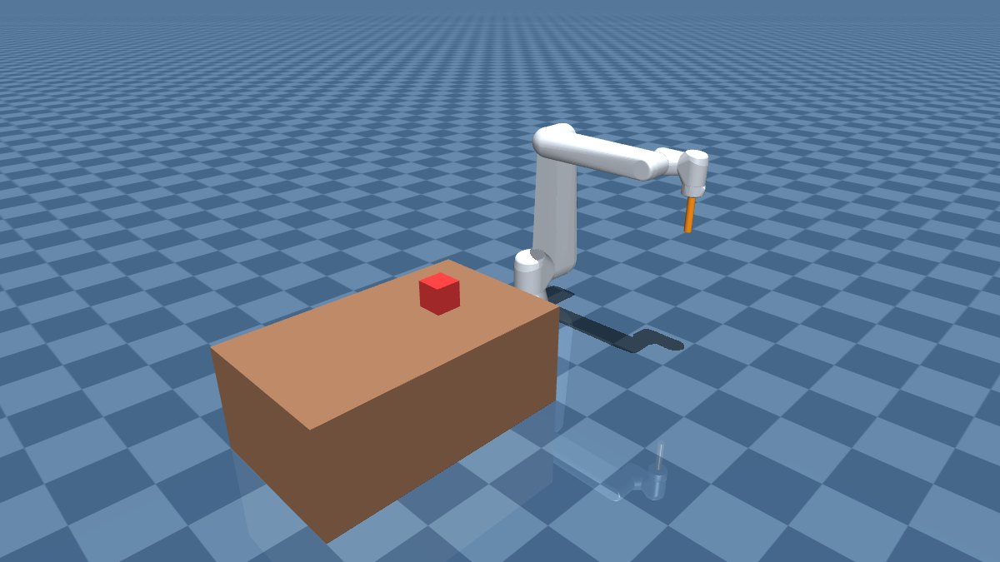

### Guarded motions: `guarded_motions/table_with_corner.xml`

Inside corner (two steel walls) on a table, to localize with guarded motions: down to the table, then +x, then +y.

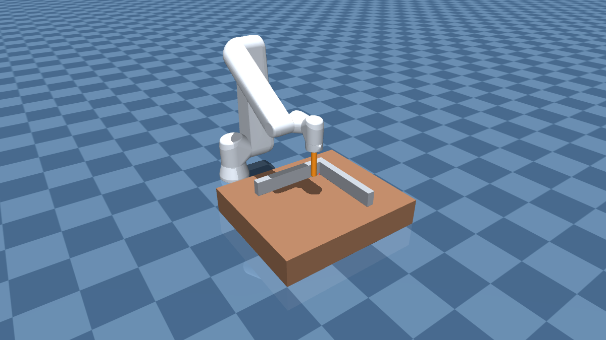 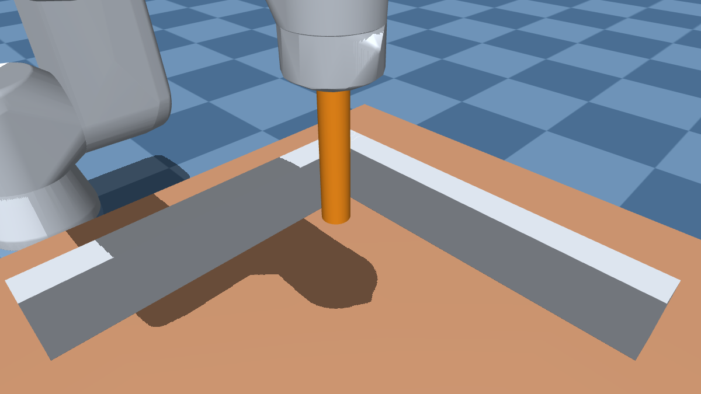

### Contour following: `contour_following/`

Circular contour (`table_with_circular_contour.xml`, inner diameter 0.35 m):

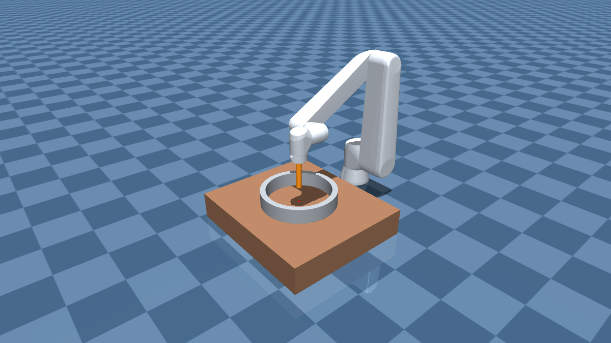 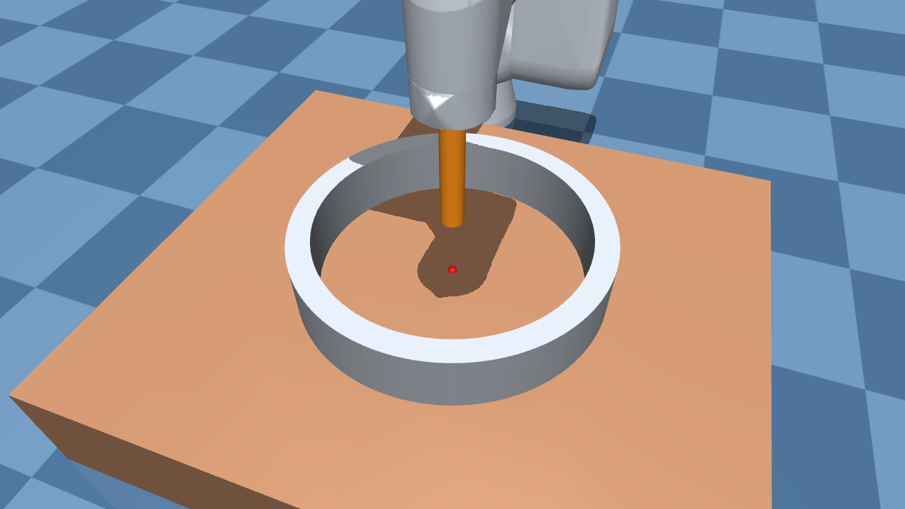

Small sine contour (`table_with_small_sine_contour.xml`, one period, amplitude 5 cm):

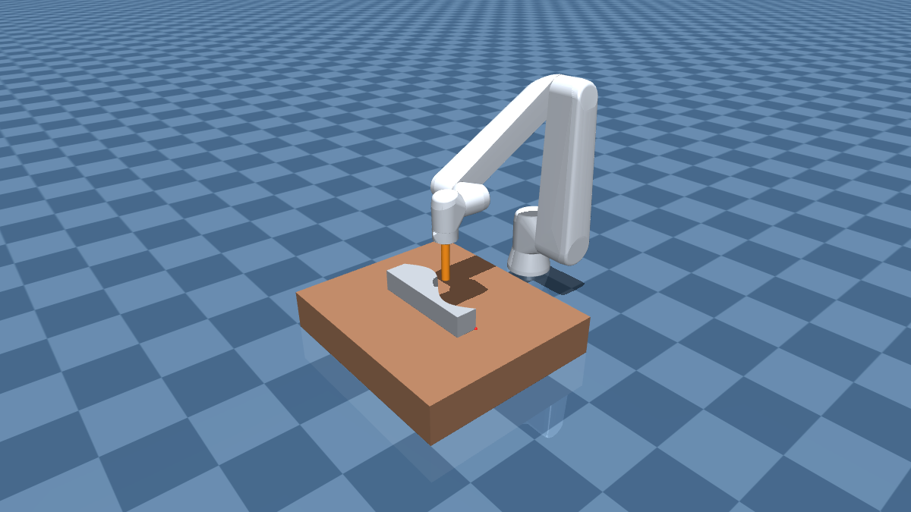 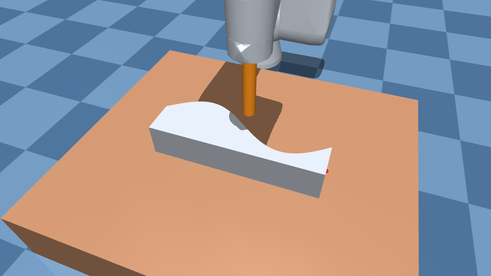

Large sine contour (`table_with_large_sine_contour.xml`, two periods, amplitude 10 cm):

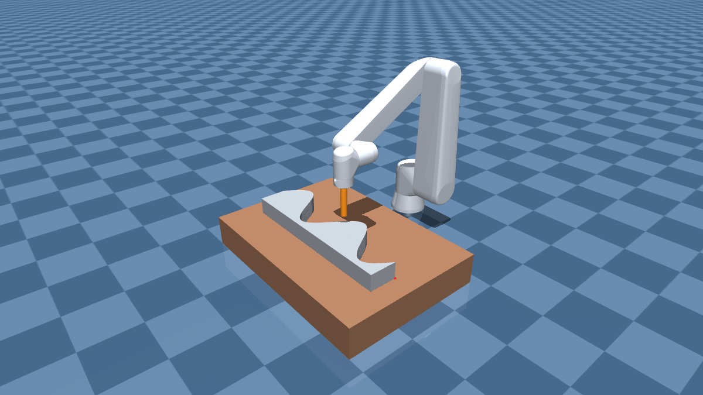 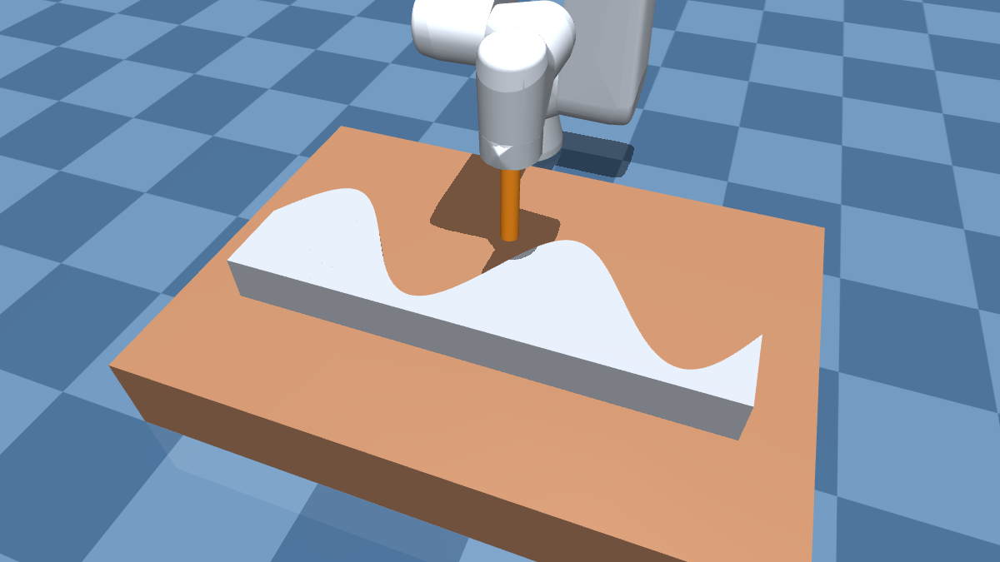

### Cylindrical peg insertion: `peg_insertion_cylindrical/`

Block with a round hole for the cylindrical peg (shown: `table_with_hole_1mm_clearance.xml`). The four files
(0.1, 0.5, 1 and 2 mm clearance) look identical at this scale: they only differ in the hole diameter (30.1 to 32 mm).

 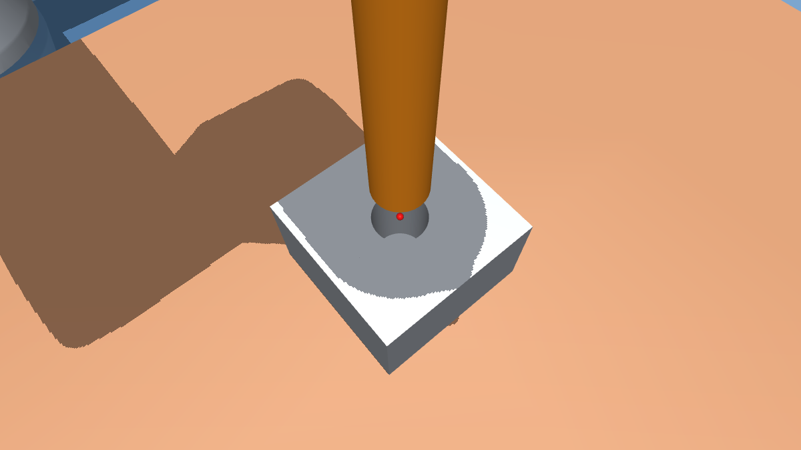

### Rectangular peg insertion: `peg_insertion_rectangular/`

Block with a rectangular hole for the rectangular peg of `ur10e_rectangular_tool.urdf` (shown:
`table_with_rectangular_hole_1mm_clearance.xml`). The four files only differ in the size of the hole.

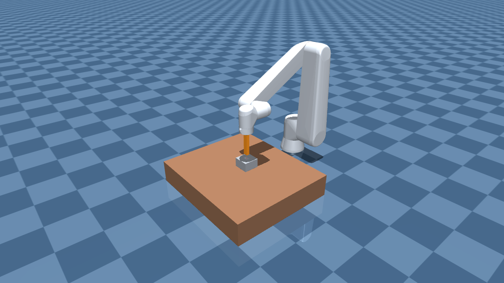 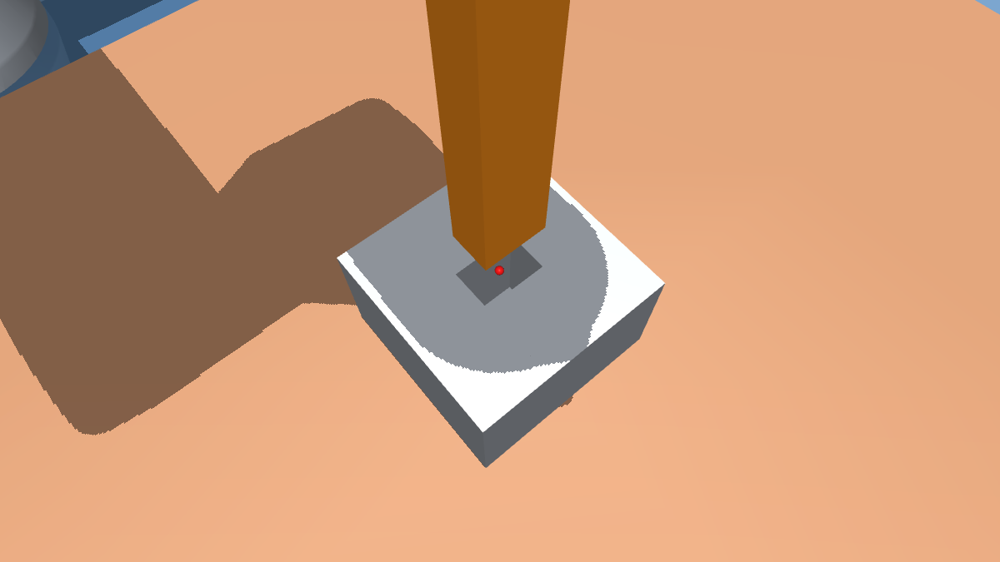

---

## How the simulation works

Crospi calls `update()` of the simulator every `periodicity` seconds in its robot driver thread (separate from the
thread that solves the eTaSL problem; both exchange data through lock-free buffers). Every `update()`:

1. reads the joint velocity setpoints computed by eTaSL;
2. advances the MuJoCo simulation by `periodicity` seconds, in `periodicity / simulation_timestep` physics steps;
3. computes the feedback and the sensor values, writes the feedback to crospi and hands the sensor values over to the
   ROS 2 publishing thread (non-blocking).

All the MuJoCo computation is done synchronously in `update()`. For a single robot arm it is cheap: about 30 µs
(kinematic) to 110 µs (position servo with the example environment) per update, i.e. ~1% of a 10 ms period. The ROS 2
publication (sensors and visualization) runs in a separate thread of the simulator's own node (`ros_node_name`).

### Control modes

| `control_mode`   | Robot | Behaviour |
|------------------|-------|-----------|
| `is-kinematic`      | kinematic | Joint positions = integral of the setpoints (perfect tracking). The robot is not stopped by contacts but pushes the objects of the environment, which are simulated dynamically. Joint torques are computed with inverse dynamics (`mj_inverse`). |
| `is-position_servo` | dynamic (forward dynamics, `mj_step`) | A joint PD controller tracks the integrated setpoint: `tau = joint_stiffness (q_ref - q) + joint_damping_gains (qd_sp - qd)`. Behaves like the internal position controller of an industrial robot: tracking errors, contacts, torque limits. |
| `is-velocity_servo` | dynamic (forward dynamics, `mj_step`) | A joint velocity controller tracks the setpoint: `tau = joint_damping_gains (qd_sp - qd)`. |

In the dynamic modes the controller runs at every physics step (e.g. 1 kHz), and:

- `control_mode/gravity_compensation: true` compensates the weight of all the robot links exactly (MuJoCo `gravcomp` with the
  masses of the URDF), as the internal controller of most industrial robots does. Without it, the position servo sags
  by about (gravity torque / `joint_stiffness`) and the velocity servo drifts down. Objects of the environment and
  payloads are not compensated.
- `control_mode/clamp_torques_to_effort_limits: true` limits the total motor torque (controller + gravity compensation) to the
  URDF effort limits (`<limit effort>`).
- When crospi activates a task (`on_activate`), the position reference is reset to the current joint positions to
  avoid wind-up.
- Stability depends on `simulation_timestep`, the gains and the joint inertia; `joint_armature` (reflected rotor
  inertia) greatly improves the stability of stiff controllers.

---

## Frames and conventions of the feedback and sensors

All values are in SI units (m, rad, s, N, Nm). The **world** frame is the world of the MuJoCo scene (the world of
the environment MJCF, or an empty world); the root link of the URDF is placed at `base_position` /
`base_quaternion_xyzw` in it. Quaternions are given as (x, y, z, w) in the configuration, in crospi and in ROS
messages.

| Quantity | crospi feedback (`name_expr_*`) | Topic (`<ns>` = `topic_namespace`) | Reference point / expressed in | Content |
|----------|------------------------------|-------------------------------------|-------------------------------|---------|
| Joint positions | always | `<ns>/joint_states` `position` | – | rad (revolute) or m (prismatic), order of `robot_joints` |
| Joint velocities | `joint_vel` | `<ns>/joint_states` `velocity` | – | rad/s or m/s |
| Joint torques | `joint_torque` | `<ns>/joint_states` `effort` | – | Nm or N. Dynamic modes: motor torque (controller + gravity compensation). Kinematic mode: inverse-dynamics torque of the commanded motion. |
| TCP pose | `cartesian_pos`, `cartesian_quat` | `<ns>/tcp_pose` (frame_id `base_link`) | pose of `tcp_link` w.r.t. `base_link` | position of the origin of `tcp_link` and its orientation, expressed in `base_link` |
| TCP twist | `cartesian_twist` | `<ns>/tcp_twist` (frame_id `base_link`) | ref. point: origin of `tcp_link`; expressed in `base_link` | linear and angular velocity of `tcp_link` relative to `base_link` |
| TCP wrench | `cartesian_wrench` | `<ns>/tcp_wrench` (frame_id `tcp_link`) | ref. point: origin of `tcp_link`; expressed in `tcp_link` | contact wrench that the end effector exerts on the environment (see below) |
| Base pose | `base_pos`, `base_quat` | `<ns>/base_pose` (frame_id `world`) | pose of `base_link` w.r.t. the world | position of the origin of `base_link` and its orientation, expressed in the world |
| Base twist | `base_twist` | `<ns>/base_twist` (frame_id `world`) | ref. point: origin of `base_link`; expressed in the world | linear and angular velocity of `base_link` (zero for a fixed robot) |
| MuJoCo sensor `<name>` | – | `<ns>/mujoco_sensors/<name>` | as defined by the [MuJoCo sensor](https://mujoco.readthedocs.io/en/stable/XMLreference.html#sensor) (e.g. `framepos` in the world unless `reftype`/`refname` are given; `touch` is a scalar normal force) | raw `sensordata` of the sensor |

**TCP wrench.** The end effector is the rigid body group of `tcp_link` (all the links welded to it with fixed joints,
e.g. `wrist_3_link`, `flange`, `ft_frame` and `tool0` of a UR robot) plus all the links mounted after it (e.g. the
`cylinder_tool` of the example URDF, or a gripper). The wrench is the sum of all the contact forces/torques between the end effector and the rest of the scene,
moved to the origin of `tcp_link`. Its sign is the wrench that the end effector **exerts on the environment**: e.g.
with `tcp_link = tool0` pointing down, pressing on a table gives a positive force along the z axis of `tool0`. It is
zero without contact and contains no gravity or inertia of the links (as an ideally compensated force/torque sensor).
In the kinematic mode, the contact forces are those consistent with the imposed motion.

`base_link` and `tcp_link` are required as soon as a quantity that uses them is fed back or published.

---

## Configuration

The simulator is configured as an entry of `robot/robotsimulators` in the crospi setup file and is selected with
`"is-mujoco_robotsimulator_crospi": true`. Every parameter is documented in the
[JSON schema](json_schemas/mujoco_robotsimulator_crospi.schema.json) (with an IDE such as VS Code, autocompletion and
documentation are available). Complete example:
[config/setups/ur10e_position_servo.setup.json](config/setups/ur10e_position_servo.setup.json):

```json
{
    "is-mujoco_robotsimulator_crospi": true,
    "robot_joints": ["shoulder_pan_joint", "shoulder_lift_joint", "elbow_joint", "wrist_1_joint", "wrist_2_joint", "wrist_3_joint"],
    "initial_joints": [0.0, -1.5708, 1.5708, -1.5708, -1.5708, 0.0],
    "periodicity": 0.01,
    "urdf_path": "$[mujoco_robotsimulator_crospi]/config/urdf/ur10e_cylinder_tool.urdf",
    "environment_mjcf_path": "$[mujoco_robotsimulator_crospi]/config/environments/pick_and_place/table_with_box.xml",
    "base_position": [0.0, 0.0, 0.0],
    "base_quaternion_xyzw": [0.0, 0.0, 0.0, 1.0],
    "add_ground_plane": false,
    "simulation_timestep": 0.001,
    "integrator": "implicitfast",
    "gravity": [0.0, 0.0, -9.81],
    "contacts_enabled": true,
    "joint_armature": [0.5, 0.5, 0.3, 0.1, 0.1, 0.1],
    "joint_damping": [1.0, 1.0, 1.0, 0.5, 0.5, 0.5],
    "control_mode": {
        "is-position_servo": true,
        "joint_stiffness": [8000.0, 8000.0, 5000.0, 1000.0, 1000.0, 1000.0],
        "joint_damping_gains": [300.0, 300.0, 150.0, 30.0, 30.0, 30.0],
        "gravity_compensation": true,
        "clamp_torques_to_effort_limits": true
    },
    "base_link": "base_link",
    "tcp_link": "tool0",
    "name_expr_joint_vel": "joint_vel",
    "name_expr_cartesian_wrench": "tcp_wrench",
    "ros_node_name": "mujoco_robotsimulator",
    "sensor_publishing": {
        "topic_namespace": "/mujoco_sim/sensors",
        "publish_period": 0.01
    },
    "visualization": {
        "model_topic": "/mujoco_sim/model",
        "state_topic": "/mujoco_sim/state",
        "publish_period": 0.033
    }
}
```

### Parameters

| Parameter | Required | Description |
|-----------|----------|-------------|
| `robot_joints`, `initial_joints` | yes | Simulated/controlled joints (names of the URDF) and their initial values. |
| `periodicity` | yes | Update period [s]; must be an integer multiple of `simulation_timestep`. |
| `urdf_path` | yes | URDF of the robot (`$[pkg]/...`, `package://pkg/...`, `file://`, absolute). |
| `environment_mjcf_path` | no | MJCF scene in which the robot is placed (same path conventions). |
| `base_position`, `base_quaternion_xyzw` | yes | Pose of the URDF root link in the world. |
| `add_ground_plane` | yes | Adds an infinite plane at z = 0. |
| `simulation_timestep`, `integrator`, `gravity`, `contacts_enabled` | yes | MuJoCo physics options (they overwrite those of the environment MJCF). `implicitfast` is recommended. |
| `joint_armature`, `joint_damping`, `joint_frictionloss` | no | Per-joint overrides of the URDF joint dynamics. |
| `control_mode` | yes | Object with exactly one mode key, `is-kinematic`, `is-position_servo` or `is-velocity_servo` (`true`), and the parameters of that mode (see below). |
| `control_mode/joint_stiffness` | `is-position_servo` | Kp of the joint controller [Nm/rad]. |
| `control_mode/joint_damping_gains` | `is-position_servo`, `is-velocity_servo` | Kd of the joint controller [Nms/rad]. |
| `control_mode/gravity_compensation`, `control_mode/clamp_torques_to_effort_limits` | `is-position_servo`, `is-velocity_servo` | See [Control modes](#control-modes). |
| `base_link`, `tcp_link` | if needed | Links used for the Cartesian/base feedback and sensors. |
| `name_expr_*` | no | Feedback channels to eTaSL (as in `simple_kinematic_simulation`). `name_expr_joint_current` is not supported. |
| `ros_node_name` | yes | ROS 2 node of the simulator (sensor publication and visualization). |
| `sensor_publishing` | yes | `topic_namespace`, `publish_period` [s] and the optional list `sensors` (all available sensors if omitted). |
| `visualization` | no | `model_topic`, `state_topic`, `publish_period` [s] for `mujoco_viewer.py`. |

The control mode follows the crospi convention of `is-<name>` discriminators: the parameters of a mode are given in
the `control_mode` object together with its `is-<mode>` key, and the JSON schema only offers (autocompletion) and
requires them for that mode (`dependencies` keyed by `is-<mode>`). Parameters that do not apply to the selected mode
are rejected, both by the schema and by the simulator:

```json
"control_mode": {"is-kinematic": true}

"control_mode": {"is-velocity_servo": true,
                 "joint_damping_gains": [500.0, 500.0, 250.0, 50.0, 50.0, 50.0],
                 "gravity_compensation": true,
                 "clamp_torques_to_effort_limits": true}
```

### Selecting the published sensors

`sensor_publishing/sensors` can contain the built-in sensors `joint_state`, `tcp_pose`, `tcp_twist`, `tcp_wrench`,
`base_pose`, `base_twist` and the names of the MuJoCo sensors of the environment MJCF:

```json
"sensor_publishing": {
    "topic_namespace": "/mujoco_sim/sensors",
    "publish_period": 0.01,
    "sensors": ["joint_state", "tcp_wrench", "table_top_touch"]
}
```

- **Omitted**: all the available sensors are published: `joint_state`; `tcp_pose` and `tcp_twist` if `base_link`
  and `tcp_link` are defined; `tcp_wrench` if `tcp_link` is defined; `base_pose` and `base_twist` if `base_link` is
  defined; every named MuJoCo sensor of the environment MJCF.
- **Specified**: only the listed sensors. A sensor whose link is not configured, or an unknown name, is an error (the
  message lists the available sensors).
- Publication is independent of the feedback to eTaSL: e.g. `tcp_wrench` can be published without
  `name_expr_cartesian_wrench`.
- Messages use reliable QoS; the header stamp is the ROS time of publication (not the simulation time). The latest
  simulated values are published every `publish_period`.
- To add sensors, add [MuJoCo sensors](https://mujoco.readthedocs.io/en/stable/XMLreference.html#sensor) (touch,
  accelerometer, framepos of an object, rangefinder, ...) to the environment MJCF and give them a name; see
  [table_with_box.xml](config/environments/pick_and_place/table_with_box.xml).

### No hidden parameters

Every parameter that influences the simulation is read from the configuration; the plugin has no internal default
values. Required parameters must be present (otherwise the simulator stops with a descriptive message), and optional
parameters only enable optional features. The only exception, requested explicitly, is `sensor_publishing/sensors`
(all sensors if omitted). Likewise, all the arguments of the executables are required.

The schema intentionally contains no `default` values, because the crospi blackboard inserts schema defaults for
missing properties, which would silently enable features or hide missing parameters. It provides `examples` instead.

---

## URDF to MuJoCo conversion

- The URDF is parsed by MuJoCo. Mesh paths (`package://`, `file://`, absolute or relative to the URDF) are resolved
  by the plugin. Xacro files are not supported: generate the URDF first (`xacro robot.urdf.xacro > robot.urdf`).
- Links attached with fixed joints (e.g. `tool0`, `flange`) are kept as separate bodies, so they can be used as
  `base_link` / `tcp_link`.
- MuJoCo only imports the **collision** geometry of the URDF, which is used for both simulation and visualization.
  Supported mesh formats: STL, OBJ, MSH (not DAE).
- Contacts between adjacent links of the robot (consecutive links in the URDF tree) are excluded, as in other
  simulators (MuJoCo itself does not filter contacts with links welded to the world).
- URDF joints not listed in `robot_joints` are simulated as passive joints.
- The URDF masses/inertias are used for the dynamics and gravity compensation, the effort limits for the torque
  clamping, and the joint limits are enforced by MuJoCo in the dynamic modes.
- The contacts present at the initial configuration are printed at initialization, which reveals an initial
  configuration in collision.

---

## Executables

All arguments are required.

| Executable | Purpose | Arguments |
|------------|---------|-----------|
| `test_mujoco_robotsimulator` | Test a simulator plugin without crospi_node | `--config` setup file, `--simulator-index` entry of `blackboard/robot/robotsimulators`, `--duration` [s], `--amplitude` [rad/s] and `--frequency` [Hz] of `qd(t) = amplitude sin(2π frequency t)` (all joints), `--real-time true\|false` (false: as fast as possible, the real-time factor is reported), `--csv <file>\|none` |
| `mujoco_viewer.py` | MuJoCo viewer mirroring the running simulation (it does not simulate) | `--model-topic`, `--state-topic` (same as `visualization` in the configuration), `--render-rate` [Hz] |
| `run_crospi_tasks.py` | Run a sequence of crospi tasks (BeTFSM) on a running crospi_node | `--task-list` task list file, `--tasks` names in execution order, `--repetitions`, `--tick-frequency` [Hz], `--publish-frequency` [Hz] (BeTFSM status); the BeTFSM web interface is disabled |

- `test_mujoco_robotsimulator` works with any crospi simulator plugin. Its CSV contains the time, setpoints, ideal and
  simulated joint positions, and the joint torques and TCP wrench if they are fed back (`name_expr_*`).
- The viewer can be started before or after the simulator and reloads the model when the simulator restarts. It
  receives the compiled model as a binary MJB, so its python `mujoco` must have the same version as the MuJoCo
  library of the plugin.
- **Wayland sessions (e.g. GNOME on Ubuntu): viewer window without title bar.** If the viewer window has no title bar
  (no close/maximize/minimize buttons, it cannot be maximized), run it with the X11 backend of GLFW:

  ```bash
  PYGLFW_LIBRARY_VARIANT=x11 ros2 run mujoco_robotsimulator_crospi mujoco_viewer.py \
      --model-topic /mujoco_sim/model --state-topic /mujoco_sim/state --render-rate 60
  ```

  Why: in a Wayland session, the python `glfw` package (used by the MuJoCo viewer) opens a native Wayland window, and
  on Wayland the application must draw its own title bar. GLFW does it through `libdecor`, which needs a decoration
  plugin (e.g. the package `libdecor-0-plugin-1-gtk`); without that plugin the window has no title bar.
  `PYGLFW_LIBRARY_VARIANT=x11` makes `glfw` use its X11 library instead: the window runs through XWayland and the
  desktop draws the usual title bar. Alternatives: install the plugin (`sudo apt install libdecor-0-plugin-1-gtk`),
  or add `export PYGLFW_LIBRARY_VARIANT=x11` to `~/.bashrc`. Without a title bar, the desktop shortcuts still work
  (e.g. GNOME: Super+Up to maximize, Alt+F4 to close).

---

## Example files

The environments are grouped by task in `config/environments/`:

| Folder | Environments |
|--------|--------------|
| `pick_and_place/` | `table_with_box.xml` |
| `guarded_motions/` | `table_with_corner.xml` |
| `contour_following/` | `table_with_circular_contour.xml`, `table_with_small_sine_contour.xml`, `table_with_large_sine_contour.xml` |
| `peg_insertion_cylindrical/` | `table_with_hole_<c>mm_clearance.xml` and their generator `generate_peg_in_hole_environments.py` |
| `peg_insertion_rectangular/` | `table_with_rectangular_hole_<c>mm_clearance.xml` and their generator `generate_rectangular_peg_in_hole_environments.py` |

The generators write the environments next to themselves (in their own folder), wherever they are run from.

| Path | Description |
|------|-------------|
| [config/setups/ur10e_kinematic.setup.json](config/setups/ur10e_kinematic.setup.json) | Kinematic mode, ground plane, viewer, publishes `joint_state`, `tcp_pose`, `tcp_twist` |
| [config/setups/ur10e_position_servo.setup.json](config/setups/ur10e_position_servo.setup.json) | Position servo in the table environment, all feedback, viewer, publishes all sensors |
| [config/setups/ur10e_velocity_servo.setup.json](config/setups/ur10e_velocity_servo.setup.json) | Velocity servo, ground plane, no viewer, publishes all sensors (`joint_state`) |
| [config/setups/ur10e_pick_and_place.setup.json](config/setups/ur10e_pick_and_place.setup.json) | Task setup: copy of `ur10e_position_servo.setup.json` with the environment `pick_and_place/table_with_box.xml` |
| [config/setups/ur10e_guarded_motions.setup.json](config/setups/ur10e_guarded_motions.setup.json) | Task setup: copy of `ur10e_position_servo.setup.json` with the environment `guarded_motions/table_with_corner.xml` |
| [config/setups/ur10e_contour_following.setup.json](config/setups/ur10e_contour_following.setup.json) | Task setup: copy of `ur10e_position_servo.setup.json` with the environment `contour_following/table_with_circular_contour.xml` (other contours: change `environment_mjcf_path`) |
| [config/setups/ur10e_peg_insertion_cylindrical.setup.json](config/setups/ur10e_peg_insertion_cylindrical.setup.json) | Task setup: copy of `ur10e_position_servo.setup.json` with the environment `peg_insertion_cylindrical/table_with_hole_1mm_clearance.xml` (other clearances: change `environment_mjcf_path`) |
| [config/setups/ur10e_peg_insertion_rectangular.setup.json](config/setups/ur10e_peg_insertion_rectangular.setup.json) | Task setup: copy of `ur10e_position_servo.setup.json` with the environment `peg_insertion_rectangular/table_with_rectangular_hole_1mm_clearance.xml` and the rectangular tool `ur10e_rectangular_tool.urdf` as peg, in the simulator and in the `default_robot_specification` (other clearances: change `environment_mjcf_path`) |
| [config/urdf/ur10e_cylinder_tool.urdf](config/urdf/ur10e_cylinder_tool.urdf) | UR10e with a cylindrical contact tool (used by all the example setups): link `cylinder_tool` (15 cm long, 3 cm diameter, solid aluminium, 0.286 kg) fixed to `tool0` along its +z axis, and the frame `tool_tip` at the center of its free end. With `tcp_link = tool0`, the wrench of contacts on the cylinder is reported at `tool0`, as a force/torque sensor between flange and tool |
| [config/urdf/ur10e_rectangular_tool.urdf](config/urdf/ur10e_rectangular_tool.urdf) | UR10e with a rectangular contact tool / peg: link `rectangular_tool` (cross-section 30 mm along x of `tool0` x 20 mm along y of `tool0`, 15 cm long, solid aluminium, 0.243 kg) fixed to `tool0` along its +z axis, and the frame `tool_tip` at the center of its free end. Use it (in `urdf_path` of the simulator and of the `default_robot_specification`) with the rectangular peg-in-hole environments |
| [config/urdf/ur10e.urdf](config/urdf/ur10e.urdf) | Plain UR10e URDF generated from `ur_description` (meshes from `package://ur_description`), without tool |
| [config/environments/pick_and_place/table_with_box.xml](config/environments/pick_and_place/table_with_box.xml) | Floor, table (top at z = 0.4 m, next to the robot on the -y side), free box; sensors `box_position`, `box_orientation`, `table_top_touch` |
| [config/environments/guarded_motions/table_with_corner.xml](config/environments/guarded_motions/table_with_corner.xml) | Corner localization with guarded motions of the cylindrical tool: table (top at z = 0.15 m) with an inside corner formed by two 8 cm walls (faces at x = 0.30 and y = -0.50; corner at (0.30, -0.50, 0.15)); at the `MoveHome` pose the tool tip is 9 cm above the table, ~11 cm from `wall_x` and ~10 cm from `wall_y`. Stiff, moderately frictional contacts; sensors `table_touch`, `wall_x_touch`, `wall_y_touch` [N] and the ground truth `corner_position` [m]. Use it via `environment_mjcf_path` |
| [config/environments/contour_following/table_with_circular_contour.xml](config/environments/contour_following/table_with_circular_contour.xml) | Contour following with force feedback: table (top at z = 0.15 m) with a hollow circular contour (ring wall, inner diameter 0.35 m, 8 cm high, made of 180 box segments, < 0.03 mm from a circle) centered at (0.174, -0.615), right below the tool at the `MoveHome` pose. The whole contour is reachable with the tool pointing down. Contact stiffness tuned for sliding without force chattering; sensors `table_touch`, `contour_touch` [N] and the ground truth `contour_center` [m]. Use it via `environment_mjcf_path` |
| [config/environments/contour_following/table_with_small_sine_contour.xml](config/environments/contour_following/table_with_small_sine_contour.xml) | Contour following with force feedback: table (top at z = 0.15 m) with a wall whose front face (robot side) is one full period of a sine, `y = -0.65 + 0.05 sin(2π (x + 0.026) / 0.40)` for x in [-0.026, 0.374] (min. radius of curvature 8.1 cm), made of 200 convex prisms (< 0.01 mm from the sine). At the `MoveHome` pose the tool is 2 cm in front of the middle of the contour. The whole contour is reachable with the tool pointing down. Same contact properties as the circular contour; sensors `table_touch`, `contour_touch` [N] and the ground truth `contour_start`, `contour_end` [m]. Use it via `environment_mjcf_path` |
| [config/environments/contour_following/table_with_large_sine_contour.xml](config/environments/contour_following/table_with_large_sine_contour.xml) | Large version of the sine contour: two periods (phase 0 to 4π) and twice the amplitude, `y = -0.68 + 0.10 sin(2π (x + 0.226) / 0.40)` for x in [-0.226, 0.574] (0.8 m long, slopes up to 57.5°, min. radius of curvature 4.05 cm), on a 1.0 x 0.7 m table, made of 400 convex prisms (< 0.05 mm from the sine). At the `MoveHome` pose the tool is in front of the middle of the contour (phase 2π). The whole contour is reachable with the tool pointing down. On the steep flanks the contact force must be applied along the measured contour normal. Sensors `table_touch`, `contour_touch` [N], `contour_start`, `contour_end` [m] |
| [config/environments/peg_insertion_cylindrical/table_with_hole_{0.1,0.5,1,2}mm_clearance.xml](config/environments/peg_insertion_cylindrical/) | Peg-in-hole insertion with the cylindrical tool as peg (Ø30 mm): steel block (10 x 10 x 6 cm) on the table with a 50 mm deep, flat-bottomed, unchamfered hole of **diametral** clearance 0.1, 0.5, 1 or 2 mm (hole Ø30.1 / 30.5 / 31 / 32 mm). Hole axis at (0.173664, -0.614962), the exact axis of the peg at the `MoveHome` pose (forward kinematics), entrance at z = 0.21, bottom at z = 0.16: a straight vertical motion from `MoveHome` (31 mm above the entrance) inserts the peg. Very stiff contacts (micrometre penetration, **requires `simulation_timestep` <= 1 ms**). Sensors `block_top_touch`, `hole_wall_touch`, `hole_bottom_touch` [N] and the ground truth `hole_entrance`, `hole_bottom` [m]. Generated with [generate_peg_in_hole_environments.py](config/environments/peg_insertion_cylindrical/generate_peg_in_hole_environments.py) (other clearances: `python3 generate_peg_in_hole_environments.py <clearance_mm> ...`) |
| [config/environments/peg_insertion_rectangular/table_with_rectangular_hole_{0.1,0.5,1,2}mm_clearance.xml](config/environments/peg_insertion_rectangular/) | Rectangular peg-in-hole with the peg of `ur10e_rectangular_tool.urdf` (30 x 20 mm): same block, depth, contact properties, sensors and timestep requirement as the cylindrical holes, with a rectangular hole of **diametral** clearance 0.1, 0.5, 1 or 2 mm in each direction (hole 30.1 x 20.1 / 30.5 x 20.5 / 31 x 21 / 32 x 22 mm), sharp edges. The hole is centered on the axis of the peg at `MoveHome` and aligned with it (rotated by -0.000789 rad about z, the yaw of `tool0` at `MoveHome`): a straight vertical motion from `MoveHome` inserts the peg. Additional sensor `hole_orientation` (ground-truth quaternion of the hole frame). Generated with [generate_rectangular_peg_in_hole_environments.py](config/environments/peg_insertion_rectangular/generate_rectangular_peg_in_hole_environments.py) (other clearances: `python3 generate_rectangular_peg_in_hole_environments.py <clearance_mm> ...`) |
| [betfsm_tasks_examples/betfsm_demos_tasks.json](betfsm_tasks_examples/betfsm_demos_tasks.json) | Task list for `run_crospi_tasks.py`. `MoveHome`, `sine`, `MoveBSpline`, `MoveBSplineCVel` use task specifications of `betfsm_demos`; `MovingDown`/`MovingUp` require `crospi_application_template` |

The setup files are in `config/setups/`: three examples of the control modes and one setup per task (one per folder of
`config/environments/`). All of them use the cylindrical tool (`ur10e_cylinder_tool.urdf`), except
`ur10e_peg_insertion_rectangular.setup.json`, which uses the rectangular tool (`ur10e_rectangular_tool.urdf`). Each setup file is a complete crospi setup: one simulator (the crospi_node constructs all the entries of
`robotsimulators`), a `default_robot_specification` with the same URDF, a `JointStateOutputHandler` (`/joint_states`)
and `"$defs": {}` (required by the crospi_node). They do not reference a bundled `"$schema"`; to use them inside an
application package (e.g. `crospi_application_template`), add the schema of this package to the bundled schema of
the application.

---

## Troubleshooting

- **Tasks end with CANCEL or the crospi_node crashes**: check that only one crospi_node is running
  (`pgrep -af crospi_node`). Two nodes with the same name confuse the orchestration.
- **Changes in the plugin have no effect**: restart the crospi_node after rebuilding (the plugin is loaded once).
- **The robot does not move in the viewer with Example 2**: the robot only moves while a task is running
  (terminal 3).
- **`Contact at the initial configuration between ...`**: printed at initialization. Expected for objects resting on
  each other (e.g. the box on the table); otherwise the initial configuration of the robot is in collision.
- **`RTPS_TRANSPORT_SHM ... open_and_lock_file failed`** printed by `ros2` tools: Fast DDS shared-memory warning,
  harmless (messages are still delivered).
- **Viewer fails to load the model**: the python `mujoco` version differs from the MuJoCo library of the plugin
  (printed when the simulator is constructed).
- **Viewer window without title bar (close/maximize/minimize) on Wayland**: start it with
  `PYGLFW_LIBRARY_VARIANT=x11 ros2 run mujoco_robotsimulator_crospi mujoco_viewer.py ...` (see
  [Executables](#executables) for the explanation).
- **The dynamic simulation is unstable**: reduce `simulation_timestep`, reduce the gains or increase
  `joint_armature`.

---

## Dependencies and build details

- crospi (`crospi_core`) and its dependencies (ROS 2 Humble or newer, Boost 1.89).
- **MuJoCo ≥ 3.3** (C API with `mjSpec`). It is not available as a rosdep key; at build time it is located, in this
  order, as:
  1. a CMake package (`find_package(mujoco CONFIG)`, e.g. MuJoCo built from source and installed);
  2. a directory given with `-DMUJOCO_DIR=<dir>` or the environment variable `MUJOCO_DIR` (release tarball layout
     `include/` + `lib/`, or the pip wheel layout);
  3. the MuJoCo python package (`pip install mujoco`), which ships the headers and `libmujoco.so`.

  The CMake output reports which installation was found; its path is embedded in the run-time path of the plugin.
- `ur_description` (Universal_Robots_ROS2_Description) for the meshes of the example UR10e.
- Viewer: python `mujoco` (same version as the library of the plugin).
- `run_crospi_tasks.py`: `betfsm`, `betfsm_ros`, `betfsm_crospi`, `betfsm_demos`.
- Plotting (optional): `plotjuggler` (e.g. `ros-<distro>-plotjuggler-ros`).

### Source code

| Path | Description |
|------|-------------|
| `src/mujoco_robotsimulator_crospi.cpp` | The plugin (`etasl::mujoco_robotsimulator_crospi`, base class `etasl::RobotSimulator`): control modes, feedback, sensors |
| `src/mujoco_simulator_config.cpp` | Reading and validation of the JSON configuration |
| `src/mujoco_scene_builder.cpp` | URDF + environment → MuJoCo model |
| `src/ros_publisher.cpp` | ROS 2 node of the simulator: sensor topics and visualization |
| `src/test_mujoco_robotsimulator.cpp`, `scripts/*.py` | Executables |
| `json_schemas/mujoco_robotsimulator_crospi.schema.json` | JSON schema of the configuration |

---

## Documentation

For documentation and tutorials, checkout our [crospi website](https://rob.pages.gitlab.kuleuven.be/crospi/), in
particular the tutorials on
[robot simulators](https://rob.pages.gitlab.kuleuven.be/crospi/markdown/advanced_tutorials/simulators/) and the
[setup configuration](https://rob.pages.gitlab.kuleuven.be/crospi/markdown/basic_tutorials/setup_configuration/).


## License and acknowledgements

Published under the [GNU LESSER GENERAL PUBLIC LICENSE](LICENSE) Version 3, 29 June 2007.


<a href="https://aiprism.eu/"></a>
This work was funded by the European Union’s Horizon 2020 research and innovation program
under the grant agreement No. <a href="https://cordis.europa.eu/project/id/101058589">101058589</a> ( <a href="https://aiprism.eu/">AI-Prism</a>)

<p/>

<p/>

<p/>

## Authors
<p float="left">
<a href="https://www.kuleuven.be/english/kuleuven/">
    
</a>
<a href="https://www.mech.kuleuven.be/en/research/ram">
    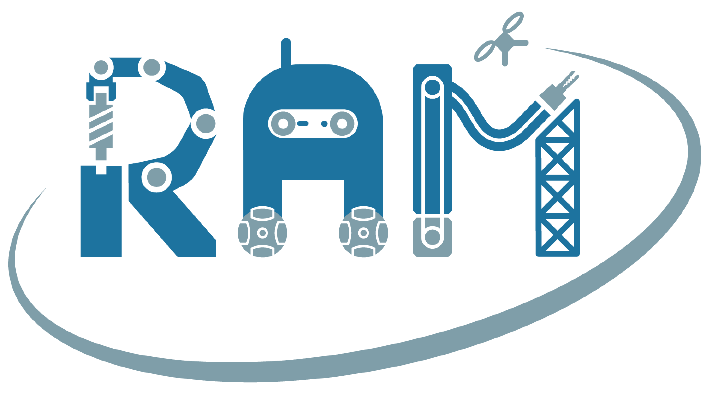
</a>
</p>

(c) 2026, KU Leuven, Department of Mechanical Engineering, ROB-Group:

- [Santiago Iregui Rincon](https://www.kuleuven.be/wieiswie/en/person/00125886)
- Claude code
